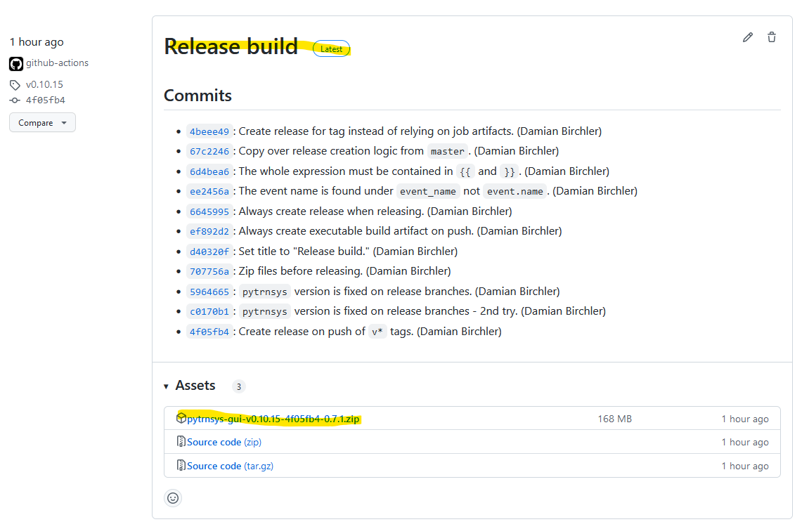
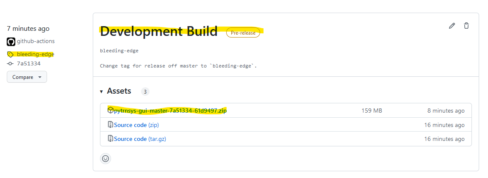

# Graphical user interface for pytrnsys

  

## Overview

A short presentation (15 min) of pytrnsys and its features can be found in the following 
[YouTube video](https://www.youtube.com/watch?v=B1BSjYRKuVM).

## Documentation

You can find the documentation under https://pytrnsys.readthedocs.io/ 

## Installation

You'll need `TRNSYS` (at least version 17, preferably version 18, 32 bit)  installed on your machine.

### Binary installation / User installation

#### Installation

##### Latest stable release

This version is recommended for **non-SPF users** and/or everyone interested in the most recent stable release
possibly missing the latest features.

Go to [Releases](https://github.com/SPF-OST/pytrnsys_gui/releases) and download the `.zip` file included in
the latest Release Build:

(Note that the version will vary as newer versions are being published)

##### Bleeding-edge version

This version is recommended for **SPF users** and/or everyone wanting to get the latest and greatest but not minding the fact
that this version is less stable (i.e. can contain more bugs/errors) than the latest stable release.

Go to [Releases](https://github.com/SPF-OST/pytrnsys_gui/releases) and download the `.zip` file included in
the `bleeding-edge` Development Build:

#### Post-installation

Copy `pytrnsys` custom TRNSYS types in the form of compiled DLLs from

    pytrnsys_data\data\ddcks\dlls
    
to the respective folder of your TRNSYS installation:

    ...\UserLib\ReleaseDLLs

#### Troubleshooting
`pytrnsys-gui.bat` writes logging messages into the `pytrnsys-gui.log` file located in the same directory
as the `.bat` file. The `.log` file might give you some hints as to what happened if something doesn't
work or if `pytrnsys-gui.bat` has crashed.

## Mass flow solver

The GUI exports a project's hydraulic network as a mass flow solver unit (`UNIT 450`) into
`ddck/hydraulic/hydraulic.ddck` and into `<project>_mfs.dck`. Which solver that unit uses is a per-project
setting, chosen as the first entry of the **Project** menu under **Mass flow solver**:

1. **Julia (Type 4750)**: a Julia script run by the julia4trnsys type 4750. Unlike Type 9352, it also solves
   networks in which a supply's flow follows only from conservation, e.g. the cold water inlet of a DHW
   system. This is the default for new projects. To use it, install the Julia solver into your TRNSYS
   installation:
   1. Unpack the julia4trnsys release zip matching your TRNSYS (32-bit or 64-bit) into the TRNSYS
      installation's `UserLib\ReleaseDLLs` (see the
      [julia4trnsys README](https://gitlab.com/spf-ost-private/julia4trnsys.rs)).
   2. Copy the `MassFlowSolver` folder into `UserLib\ReleaseDLLs` as well, e.g.
      `...\UserLib\ReleaseDLLs\MassFlowSolver\MassFlowSolver.jl` (see the
      [Julia mass flow solver README](https://github.com/SPF-OST/fortrnsys/blob/main/types/hydraulics/julia-massFlowSolver/README.md)).
2. **Type 9352**: the Fortran type whose DLL is shipped with `pytrnsys` (see Post-installation above).
   Projects saved by older GUI versions use it until the setting is changed.

Changing the setting marks the project as modified; if `ddck/hydraulic/hydraulic.ddck` exists, it has to be
exported again (Project > Export hydraulic.ddck) to use the new solver. `ddck/control/hydraulic_control.ddck`
doesn't depend on the solver and doesn't need to be exported again.

## Developers
See [DEVELOPER-README.md](DEVELOPER-README.md).